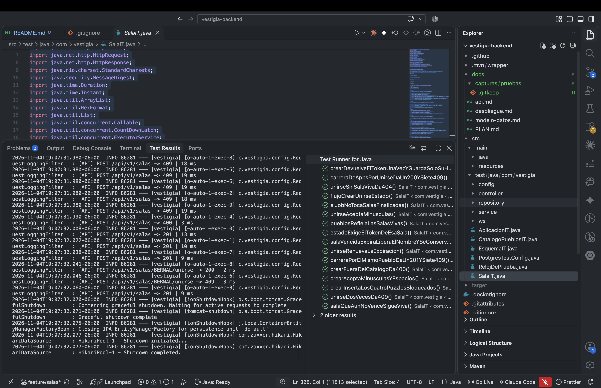

# Vestigia backend

Backend de **Vestigia**, el proyecto integrador del grupo IDGS101N de la Universidad Tecnológica de Chihuahua. Vestigia es un videojuego de misterio para PC (Unity) con una app móvil (Flutter) que funciona como la libreta de la protagonista. El juego y la app no se hablan entre sí. Los dos usan este backend por REST y WebSocket, y el backend guarda el estado de cada sala en PostgreSQL.

| Documento | Qué tiene |
|---|---|
| [`docs/integracion-unity.md`](docs/integracion-unity.md) | Guía paso a paso para quien programa el juego en Unity: cada petición en orden, tiempo real, banderas y un cliente C# |
| [`docs/integracion-flutter.md`](docs/integracion-flutter.md) | Guía paso a paso para quien programa la app en Flutter: unirse, libreta, burbuja, avisos de puzzle, tiempo real y un cliente Dart |
| [`docs/integracion-pwa.md`](docs/integracion-pwa.md) | Guía para quien programa la PWA: `VITE_API_URL`, CORS, tipos de TypeScript, un hook de React y lo que todavía no existe |
| [`docs/api.md`](docs/api.md) | Endpoints REST con ejemplos de `curl` y errores, para quien integra Unity o Flutter |
| [`docs/tiempo-real.md`](docs/tiempo-real.md) | WebSocket de `/ws`: autenticación, mensajes con ejemplos, errores, cierres y limitaciones |
| [`docs/modelo-datos.md`](docs/modelo-datos.md) | Tablas, ciclo de vida de una sala y qué se guarda de cada token |
| [`docs/despliegue.md`](docs/despliegue.md) | Despliegue en Railway |

## Cómo funciona

Todo gira alrededor de la **sala**, que identifica una partida con el nombre de un Pueblo Mágico en mayúsculas, sin acentos y de una sola palabra (por ejemplo `BACALAR`). El catálogo de pueblos es fijo y vive en la base de datos.

1. **El juego crea la sala.** Cuando la jugadora elige un pueblo, el juego llama a `POST /api/v1/salas`. La sala nace en `esperando_app` con sus cuatro puzzles (`radio`, `photo`, `lookout`, `observatory`) bloqueados, y el juego recibe su token.
2. **La app se une.** La app móvil llama a `POST /api/v1/salas/{codigo}/unirse` y recibe su propio token. Cada sala admite una sola app. La sala pasa a `activa`.
3. **Los dos consultan el estado.** Con su token, el juego y la app llaman a `GET /api/v1/salas/{codigo}/estado` para ver la escena, los puzzles, los descubrimientos y qué dispositivos están conectados.
4. **Durante la partida.** El juego y la app registran descubrimientos (`POST /api/v1/salas/{codigo}/descubrimientos`) y el juego cambia la escena (`PUT /api/v1/salas/{codigo}/escena`). Con cada descubrimiento nuevo, el backend revisa qué puzzles ya cumplen sus requisitos y los pasa a `disponible`. Quien juega un puzzle avisa cuando empieza o se completa (`PUT /api/v1/salas/{codigo}/puzzles/{puzzle}`). Al resolverse, el backend crea su descubrimiento resultado, como las coordenadas `137` y `+042`, y habilita los puzzles que dependen de él.
5. **La sala termina.** El juego la cierra con `DELETE /api/v1/salas/{codigo}` y queda `finalizada`. Si pasa tiempo sin ninguna escritura (2 horas por defecto), un job la marca `expirada`. En los dos casos el código vuelve a quedar libre, los tokens dejan de servir y la sala se conserva como historial.

**Tokens y roles.** Cada dispositivo recibe un token aleatorio y opaco que se envía como `Authorization: Bearer <token>`. El backend guarda solo su hash SHA-256. El token determina la sala y el rol (`juego` o `app`), y solo funciona con el código de su propia sala.

**Un código, una sala viva.** Un índice único parcial en PostgreSQL impide que dos juegos reclamen el mismo pueblo a la vez. El que pierde recibe `409`.

**Errores.** Todos tienen el mismo cuerpo JSON (`timestamp`, `status`, `error`, `codigo`, `message`, `path`, `details`). `codigo` siempre viene y vale `null` salvo en los errores que definen uno, como `puzzle_bloqueado`. Los campos del JSON van en `snake_case` y las fechas en UTC con formato ISO-8601.

**Tiempo real.** El juego y la app abren un WebSocket en `/ws` y se autentican con su token en el primer mensaje (`{"type":"auth","payload":{"token":"..."}}`), nunca en la URL. El backend les avisa quién está conectado y, después de confirmar cada escritura en la base, qué cambió: puzzles, descubrimientos, escena (solo a la app) y cierre de la sala. Los detalles están en [`docs/tiempo-real.md`](docs/tiempo-real.md). Las conexiones viven en memoria, así que el backend corre en una sola instancia.

**Qué hay disponible hoy.** Pueblos, crear sala, unirse, estado, descubrimientos, puzzles, escena, cierre de sala, el WebSocket de `/ws` y `/actuator/health`. Cada escritura renueva la expiración de la sala y deja un evento en la tabla `eventos`. Swagger UI documenta cada endpoint con ejemplos reales y sus errores, y la página `/prueba-ws.html` muestra los mensajes del WebSocket sin Unity ni Flutter.

## Stack

- Java 21 y Spring Boot 4.1.1, compilado con Maven a través del wrapper `./mvnw`.
- PostgreSQL. Flyway crea el esquema al arrancar con las migraciones de `src/main/resources/db/migration/`.
- WebSocket simple en `/ws`, sin STOMP ni SockJS.
- Swagger UI con springdoc en `/swagger-ui/index.html` y el documento OpenAPI en `/v3/api-docs`: descripciones en español, ejemplos de petición y respuesta, errores con `codigo` y el esquema `Bearer`.
- Página de prueba del WebSocket en `/prueba-ws.html` (`src/main/resources/static/`).
- Pruebas de integración contra un Postgres real con Testcontainers.

## Levantarlo en local

Necesitas Java 21 y Docker.

1. Arranca un Postgres con los valores de desarrollo por defecto:

	```sh
	docker run -d --name vestigia-pg -e POSTGRES_DB=vestigia -e POSTGRES_PASSWORD=postgres -p 5432:5432 postgres:17-alpine
	```

2. Arranca el backend desde la raíz del repo:

	```sh
	./mvnw spring-boot:run
	```

3. Comprueba que responde:

	```sh
	curl http://localhost:8080/actuator/health
	```

	La respuesta incluye `"status":"UP"`.

4. Prueba el flujo de una sala (necesita `jq`):

	```sh
	TOKEN=$(curl -s -X POST http://localhost:8080/api/v1/salas \
		-H 'Content-Type: application/json' -d '{"codigo":"bacalar"}' | jq -r .token)
	curl -s -X POST http://localhost:8080/api/v1/salas/BACALAR/unirse
	curl -s http://localhost:8080/api/v1/salas/BACALAR/estado -H "Authorization: Bearer $TOKEN"
	```

	Swagger UI con todos los endpoints está en `http://localhost:8080/swagger-ui/index.html`. El detalle de cada respuesta y error está en [`docs/api.md`](docs/api.md).

5. Para ver los mensajes del WebSocket, abre `http://localhost:8080/prueba-ws.html`, pega el token en el panel del juego y pulsa **Conectar**. El token viaja solo en el mensaje `auth`, nunca en la URL.

Si el puerto 5432 ya está ocupado, publica Postgres en otro puerto (`-p 55432:5432`) y arranca con `DB_URL=jdbc:postgresql://localhost:55432/vestigia ./mvnw spring-boot:run`.

Si tu Postgres usa otras credenciales, copia `application-local.properties.example` como `application-local.properties` en la raíz del repo y edítalo. Git ignora ese archivo.

## Variables de entorno

| Variable | Para qué | Valor de desarrollo |
|---|---|---|
| `DB_URL` | URL JDBC de Postgres, con la forma `jdbc:postgresql://host:puerto/base` | `jdbc:postgresql://localhost:5432/vestigia` |
| `DB_USER` | Usuario de Postgres | `postgres` |
| `DB_PASSWORD` | Contraseña de Postgres | `postgres` |
| `PORT` | Puerto HTTP del servidor | `8080` |
| `CORS_ALLOWED_ORIGINS` | Orígenes permitidos para `/api/**` y para conectarse a `/ws` desde un navegador, separados por comas | `http://localhost:5173,http://localhost:4173` |

Cada valor se busca primero en las variables de entorno, luego en `application-local.properties` y al final se usa el valor de desarrollo. Por eso `application-local.properties` declara `DB_URL`, `DB_USER` y `DB_PASSWORD`, no `spring.datasource.*`. Con `spring.datasource.*`, el archivo local taparía a las variables de entorno.

No subas contraseñas, tokens ni URLs con credenciales al repo.

## Expiración de salas

Una sala viva sin actividad pasa a `expirada` y su código vuelve a quedar libre. Dos propiedades lo controlan. Tienen su valor por defecto en `application.properties` y se pueden cambiar en `application-local.properties` o con las variables de entorno `VESTIGIA_SALAS_EXPIRACION` y `VESTIGIA_SALAS_EXPIRACIONREVISION`.

| Propiedad | Para qué | Valor por defecto |
|---|---|---|
| `vestigia.salas.expiracion` | Tiempo sin actividad tras el cual una sala viva expira, en formato ISO-8601 | `PT2H` |
| `vestigia.salas.expiracion-revision` | Cada cuánto corre el job que marca las salas vencidas | `PT1M` |
| `vestigia.descubrimientos.datos-max-bytes` | Tamaño máximo de los `datos` de un descubrimiento, en bytes de JSON | `4096` |
| `vestigia.ws.auth-plazo` | Tiempo que tiene un cliente de `/ws` para mandar `auth` | `PT5S` |
| `vestigia.ws.ping` | Cada cuánto manda el servidor un ping a cada conexión de `/ws` | `PT25S` |
| `vestigia.ws.mensaje-max-caracteres` | Tamaño máximo de un mensaje que manda un cliente por `/ws` | `4096` |
| `vestigia.ws.envio-limite` | Tiempo máximo de un envío a un cliente de `/ws` que no lee; luego se cierra esa conexión | `PT5S` |
| `vestigia.ws.envio-max-bytes` | Bytes que pueden esperar en la cola de salida de una conexión de `/ws`; más la cierran | `65536` |

## Coordenadas del misterio

El servidor entrega dos coordenadas al resolver puzzles: la ascensión recta al resolver `radio` (`coordenada_a`) y la declinación al resolver `photo` (`coordenada_b`). Son los únicos valores del misterio que viven en el backend. Se leen como texto, así que conservan el signo y los ceros. Se cambian como las de expiración, también con `VESTIGIA_PUZZLES_COORDENADAS_AR` y `VESTIGIA_PUZZLES_COORDENADAS_DEC`.

| Propiedad | Para qué | Valor por defecto |
|---|---|---|
| `vestigia.puzzles.coordenadas.ar` | `valor` de `coordenada_a` (ascensión recta) | `137` |
| `vestigia.puzzles.coordenadas.dec` | `valor` de `coordenada_b` (declinación) | `+042` |

## Correr las pruebas
- `./mvnw test` corre las pruebas unitarias y las de `@WebMvcTest`. No necesita Docker.
- `./mvnw verify` corre además las clases `*IT` con maven-failsafe. Esas pruebas arrancan un `postgres:17-alpine` con Testcontainers, así que Docker tiene que estar corriendo.
- `python3 scripts/resumen-pruebas.py` lee los reportes de `target/surefire-reports` y `target/failsafe-reports` y escribe en Markdown el conteo y la lista de pruebas, con el `@DisplayName` de cada una. Córrelo después de `./mvnw clean verify`: sin `clean` pueden quedar reportes de una corrida anterior. Con `--solo-conteo` imprime una sola línea. Sale con código distinto de 0 si no hay reportes, si alguna prueba falló o si falta una de las dos carpetas (por ejemplo, tras `./mvnw test`); en ese último caso avisa y marca el conteo como incompleto.
- `DocumentacionIT` compara las rutas de `/v3/api-docs` con las de los controladores, y `JsonDocumentadoIT` compara cada bloque JSON de respuesta de `docs/api.md`, `docs/tiempo-real.md` y las tres guías con una respuesta real del backend (campos y tipos). Por eso cada bloque ```` ```json ```` de esos documentos lleva justo antes `<!-- respuesta: tipo -->` o `<!-- peticion -->`; un bloque sin marca hace fallar la prueba.
- La evidencia de pruebas de cada paso vive en [`docs/pruebas/`](docs/pruebas/README.md).

## Capturas de pruebas 
### Test de Salas corriendo:


## Construir y correr la imagen Docker

El `Dockerfile` compila en una etapa con JDK 21 y corre el JAR en otra con JRE 21, con el usuario sin privilegios `vestigia`. La imagen no corre las pruebas.

```sh
docker build -t vestigia-backend .
docker run --rm -p 8080:8080 \
	-e DB_URL=jdbc:postgresql://host.docker.internal:5432/vestigia \
	-e DB_USER=postgres -e DB_PASSWORD=postgres \
	vestigia-backend
```

`host.docker.internal` apunta a tu máquina en Docker Desktop. En Linux, pon el contenedor del backend y el de Postgres en la misma red de Docker y usa el nombre del contenedor de Postgres como host.

## Prueba de humo

`scripts/smoke-test.sh` recorre una partida completa con `curl` y `jq` contra un backend que ya esté corriendo: health, crear sala, unirse, escenas, banderas del juego, los cuatro puzzles, estado y cierre. Recibe la URL base y, opcionalmente, el pueblo; sin pueblo, toma uno libre.

```sh
scripts/smoke-test.sh http://localhost:8080
scripts/smoke-test.sh http://localhost:8080 BACALAR
```

Imprime cada paso con ✓ y termina con `RESULTADO: ✅`. Si un paso falla, dice cuál, muestra la respuesta y sale con código `1` (`2` si falta la URL, `3` si falta `curl` o `jq`, y `129`, `130` o `143` si se interrumpe). Pase lo que pase, al salir cierra la sala que creó, para no dejar el pueblo ocupado. Nunca imprime los tokens. Cómo correrlo contra Railway está en [`docs/despliegue.md`](docs/despliegue.md). `SmokeTestIT` y `SmokeTestFalloIT` lo corren en `./mvnw verify` contra el backend real y `SmokeTestServidorFalsoIT` contra un servidor falso, así que esas pruebas necesitan `bash`, `curl` y `jq`.

## Despliegue

El backend se despliega en Railway desde `main`. [`docs/despliegue.md`](docs/despliegue.md) tiene las variables y su mapeo desde el Postgres de Railway, lo que se verificó con la imagen, las decisiones pendientes (Swagger y la página de prueba en producción, el proxy TLS) y la lista paso a paso del primer despliegue.
