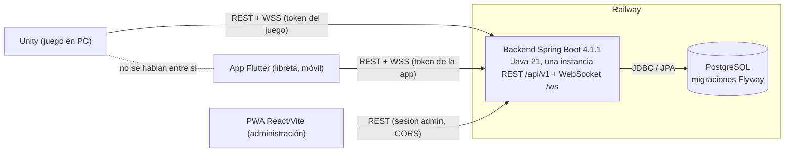

# Informe de métricas del backend de Vestigia

Insumo para el informe académico sobre métricas de rendimiento de aplicaciones.

- **Fecha del informe:** 2026-11-09
- **Commit analizado:** `6a51818` (rama `feature/admin-salas`, árbol limpio; no se modificó código del proyecto)
- **Convención de fuentes:** cada sección indica el archivo, comando o salida de donde sale el dato. Lo que no se pudo obtener dice "No disponible" y por qué.
- **Secretos:** este documento no incluye contraseñas, tokens, ni credenciales de base de datos. Los tokens de las mediciones se usaron en memoria y las salas de prueba se cerraron al final.

---

## 1. Resumen técnico

### 1.1 Plataforma y dependencias

Fuente: `pom.xml`, `java -version`.

| Elemento | Valor |
|---|---|
| Java (propiedad `java.version` del `pom.xml`) | 21 (JDK local de medición: OpenJDK 21.0.13 LTS) |
| Spring Boot (`spring-boot-starter-parent`) | 4.1.1 |
| Gestor de build | Maven con wrapper (`./mvnw`), empaquetado JAR |
| Artefacto | `com.vestigia:vestigia:0.0.1-SNAPSHOT` |

Dependencias de ejecución (`pom.xml`):

| Artefacto | Para qué |
|---|---|
| `spring-boot-starter-webmvc` | API REST (Spring MVC) |
| `spring-boot-starter-websocket` | WebSocket simple en `/ws` |
| `spring-boot-starter-data-jpa` | JPA/Hibernate |
| `spring-boot-starter-validation` | Validación de DTOs |
| `spring-boot-starter-actuator` | Salud |
| `spring-boot-starter-flyway` y `flyway-database-postgresql` | Migraciones |
| `postgresql` | Driver JDBC |
| `springdoc-openapi-starter-webmvc-ui` 3.1.1 | Swagger UI / OpenAPI |
| `spring-security-crypto` | BCrypt para contraseñas de administradores (solo el módulo de cifrado, no Spring Security completo) |

Dependencias de prueba: `spring-boot-starter-data-jpa-test`, `-validation-test`, `-webmvc-test`, `spring-boot-testcontainers` y `testcontainers-postgresql`.

No hay JaCoCo ni ningún plugin de cobertura (`grep -c jacoco pom.xml` devuelve 0).

### 1.2 Base de datos y conexión

Fuente: `src/main/resources/application.properties`.

| Aspecto | Valor |
|---|---|
| Base de datos | PostgreSQL (única) |
| Acceso | Spring Data JPA / Hibernate. `spring.jpa.hibernate.ddl-auto=validate` (Hibernate solo valida; el esquema lo crea Flyway) |
| Driver | `org.postgresql:postgresql` (JDBC) |
| Parámetros de conexión | Variables `DB_URL`, `DB_USER`, `DB_PASSWORD` (con valores de desarrollo local por defecto). No se reproducen valores aquí |
| `spring.jpa.open-in-view` | `false` (la sesión de Hibernate no se mantiene abierta durante la vista) |
| Pool de conexiones | **No hay configuración explícita**: no existe ninguna propiedad `spring.datasource.hikari.*` en el repo (`grep -ri hikari src/main` sin resultados). Se usa el pool por defecto de Spring Boot, HikariCP. El tamaño máximo por defecto de HikariCP es 10, pero ese valor es el predeterminado de la biblioteca y no se verificó en ejecución (el endpoint de métricas no está expuesto, ver 7.7) |
| Serialización | Jackson 3, `snake_case`, fechas `Instant` en UTC ISO-8601 |
| Hilos de programación | `spring.task.scheduling.pool.size=2` (comparten auth del WS, pings y job de expiración) |

### 1.3 Estructura de paquetes y tamaño

Fuente: `find src -name "*.java"` agrupado por directorio.

| Paquete `com.vestigia.…` | Archivos | Contenido |
|---|---:|---|
| `controller` | 9 | 7 controladores REST (`Sala`, `Descubrimiento`, `Puzzle`, `Pueblo`, `Auth`, `Usuario`, `AdminSala`), `ApiExceptionHandler` y `EjemplosOpenApi` |
| `dto` | 17 | Records que viajan en JSON (`Sala`, `*Request`, `SesionIniciada`, …) |
| `model` | 7 | Entidades JPA con sufijo `Model` (`SalaModel`, `PuzzleEstadoModel`, `DescubrimientoModel`, `EventoModel`, `CodigoPuebloModel`, `UsuarioModel`, `SesionAdminModel`) |
| `repository` | 7 | Repositorios Spring Data JPA |
| `service` | 10 | Lógica de negocio (`SalaService`, `PuzzleService`, `DescubrimientoService`, `HabilitacionPuzzlesService`, `ActividadService`, `AuthService`, `UsuarioService`, `AdminSalaService`, …) |
| `ws` | 5 | `SalaWebSocketHandler`, `SesionesWebSocket`, `EmisorEventos`, `Mensaje`, `Cierre` |
| `config` | 13 | CORS, filtro de log, interceptores de token (`TokenInterceptor`, `AdminInterceptor`), WebSocket, seguridad, OpenAPI, etc. |
| raíz | 1 | `VestigiaApplication` |
| **Total main** | **69** | |

Pruebas: 38 clases en `src/test/java` (ver sección 5).

---

## 2. Arquitectura y despliegue

### 2.1 Despliegue en Railway

Fuente: `Dockerfile`, `CLAUDE.md` §10, `docs/despliegue.md`, cabeceras HTTP de la URL pública.

- **Servicios:** un servicio para el backend (construido con el `Dockerfile`) y un servicio PostgreSQL, en el mismo proyecto de Railway.
- **Dockerfile de dos etapas:**
  1. `eclipse-temurin:21-jdk` compila con `./mvnw package -DskipTests` (las pruebas corren en CI, no en la imagen).
  2. `eclipse-temurin:21-jre` ejecuta `java -jar app.jar` con un usuario sin privilegios (`vestigia`), puerto 8080 expuesto. No se fijan opciones de JVM (`-Xmx`, etc.): la JVM usa sus valores por defecto.
- **Health check:** `/actuator/health`.
- **Migraciones:** Flyway migra al arrancar.
- **Despliegue desde `main`.** El workflow `salud-produccion.yml` valida el health tras cada despliegue.
- **Instancia única:** las sesiones WebSocket viven en memoria, así que el backend se ejecuta en una sola instancia (limitación conocida, `CLAUDE.md` §7).
- **Borde de red (medido):** la respuesta incluye la cabecera `x-railway-edge: lax1` (Los Ángeles). Es el borde que atiende las peticiones; no se verificó la región del contenedor.

Variables de entorno que usa la aplicación (solo nombres):

| Variable | Uso |
|---|---|
| `DB_URL`, `DB_USER`, `DB_PASSWORD` | Conexión a PostgreSQL (en Railway se toman por variables de referencia del servicio de Postgres) |
| `PORT` | Puerto del servidor (por defecto 8080) |
| `CORS_ALLOWED_ORIGINS` | Orígenes de navegador permitidos (también para el handshake de `/ws`) |
| `ADMIN_BOOTSTRAP_EMAIL`, `ADMIN_BOOTSTRAP_PASSWORD` | Crean el primer administrador si no hay usuarios |

### 2.2 Diagrama



Los clientes nunca se comunican directamente: todo pasa por el backend, que guarda el estado de cada sala (`CLAUDE.md` §1).

---

## 3. Endpoints

Fuente: anotaciones `@RequestMapping`/`@GetMapping`/… de `src/main/java/com/vestigia/controller/`, `docs/api.md` (ejemplos de respuesta, que el repo indica haber obtenido de ejecuciones reales) y `docs/tiempo-real.md`. Los códigos de estado de cada medición de la sección 7 se verificaron contra producción.

### 3.1 API REST (`/api/v1`)

Autenticación: el juego y la app usan un token opaco de sala (`Authorization: Bearer <token>`); la PWA usa un token de sesión de administración distinto. Los tokens no se intercambian entre sí. Los errores usan un JSON uniforme (`timestamp, status, error, codigo, message, path, details`).

| Método y ruta | Rol | Descripción | Parámetros | Ejemplo de respuesta |
|---|---|---|---|---|
| `GET /pueblos` | público | Catálogo de 101 pueblos; ocupados con `libre:false` | `disponibles=true` para solo libres | `200` `[{"codigo":"ACAXOCHITLAN","libre":true}, …]` |
| `POST /salas` | público | El juego reclama un pueblo y crea la sala | Cuerpo `{codigo}` | `201` `{"codigo":"BACALAR","estado":"esperando_app","token":"…"}`; `400` fuera de catálogo; `409` ocupado |
| `POST /salas/{codigo}/unirse` | público | La app se une (una sola por sala) | — | `200` `{"token":"…"}`; `404` no existe; `409` ya hay app |
| `GET /salas/{codigo}/estado` | juego o app | Estado completo: escena, 4 puzzles, descubrimientos, dispositivos conectados | — | `200` `{"codigo":"BACALAR","estado":"activa","escena_actual":"introduccion","puzzles":[{"puzzle":"radio","estado":"bloqueado","datos":{}}, …],"descubrimientos":[],"dispositivos":{"juego":false,"app":false},"creada_en":"…","expira_en":"…"}`. No renueva la expiración |
| `PUT /salas/{codigo}/escena` | juego | Cambia la escena (`introduccion`, `pueblo`, `faro`, `observatorio`, `desenlace`) | Cuerpo `{escena}` | `200` `{"escena_actual":"faro"}`; `403` si la manda la app |
| `POST /salas/{codigo}/descubrimientos` | juego o app | Registra un descubrimiento (idempotente por `clave`; `datos` máx. 4096 bytes) | Cuerpo `{clave, datos}` | `201` nuevo / `200` repetido: `{"clave":"pieza_1","datos":{"lugar":"muelle"},"origen":"juego","creado_en":"…"}`; `403` con `codigo` `clave_solo_juego` o clave de servidor |
| `PUT /salas/{codigo}/puzzles/{puzzle}` | solo app | Avisa que un puzzle (`radio`, `photo`, `lookout`, `observatory`) se inició o completó | Cuerpo `{datos:{iniciado:true}}`, `{datos:{sintonizada:true}}` (radio) o `{datos:{completada:true}}` | `200` `{"puzzle":"photo","estado":"resuelto","datos":{"completada":true}}`; `403` `puzzle_solo_app`; `409` `puzzle_bloqueado`; `400` id o forma inválida |
| `DELETE /salas/{codigo}` | juego | Cierra la sala (`finalizada`); ambos tokens dejan de servir | — | `204` sin cuerpo |
| `POST /auth/login` | público | Inicio de sesión de administrador (BCrypt, límite de 5 fallos por correo en 15 min) | Cuerpo `{correo, password}` | `200` `{"token":"…","expira_en":"…","usuario":{"id","nombre","correo","rol","activo","creado_en"}}`; `401`; `429` `demasiados_intentos` |
| `POST /auth/logout` | sesión admin | Cierra la sesión | — | `204` |
| `GET /auth/yo` | sesión admin | Usuario dueño de la sesión | — | `200` `{"id","nombre","correo","rol":"admin","activo":true,"creado_en"}` |
| `GET /admin/usuarios` | sesión admin | Lista de usuarios | — | `200` arreglo de usuarios (sin contraseñas) |
| `POST /admin/usuarios` | sesión admin | Crea usuario | Cuerpo `{nombre, correo, password(8–72), rol}` | `201` usuario; `409` `correo_duplicado` |
| `PUT /admin/usuarios/{id}` | sesión admin | Cambia nombre, rol, activo o contraseña | Cuerpo con campos opcionales | `200` usuario; `409` `ultimo_admin` |
| `DELETE /admin/usuarios/{id}` | sesión admin | Elimina usuario y sus sesiones | — | `204`; `409` `ultimo_admin` |
| `GET /admin/salas` | sesión admin | Todas las salas (vivas y terminadas), de más nueva a más antigua | `estado`, `limite` (1–500, por defecto 100) | `200` `[{"id","codigo","estado","escena_actual","puzzles_resueltos","puzzles_total","app_unida","dispositivos":{…},"creada_en","ultima_actividad","expira_en"}]` |
| `GET /admin/salas/{id}` | sesión admin | Detalle de una sala con su bitácora de eventos | — | `200` detalle |
| `DELETE /admin/salas/{id}` | sesión admin | Cierre forzado idempotente (emite `sala.cerrada`) | — | `204` |

Rutas fuera de `/api/v1` (verificadas contra producción en la sección 7):

| Ruta | Estado en producción |
|---|---|
| `GET /actuator/health` | `200` `{"groups":["liveness","readiness"],"status":"UP"}` |
| `GET /v3/api-docs` | `200` (especificación OpenAPI) |
| `GET /swagger-ui/index.html` | Público (decisión documentada en `CLAUDE.md`) |
| `GET /actuator/metrics` | **`404`**: solo se expone `health` (`management.endpoints.web.exposure.include=health`) |

Ninguno de los endpoints de `/auth` ni `/admin` se midió: requieren credenciales de administrador de producción, que no se tienen ni se piden por chat (`CLAUDE.md` §9).

### 3.2 WebSocket

Fuente: `docs/tiempo-real.md`, `WebSocketConfig.java`, `application.properties`.

- **Ruta:** `wss://<host>/ws` (WebSocket simple, sin STOMP ni SockJS). Mensajes JSON `{"type": "...", "payload": {...}}`.
- **Conexión:** el cliente abre `/ws` y en menos de 5 s manda `{"type":"auth","payload":{"token":"…"}}` (el token no va en la URL). El servidor responde `auth.ok` con `{rol, sala}`.
- **Orígenes:** los navegadores deben estar en `CORS_ALLOWED_ORIGINS`; Unity y Flutter nativo no mandan `Origin`.
- **Ping:** el servidor envía ping del protocolo cada 25 s.
- **Límites:** mensaje del cliente ≤ 4096 caracteres; cola de salida por conexión ≤ 64 KB; envío atascado ≥ 5 s corta la conexión.

| `type` | Emite | Recibe | `payload` |
|---|---|---|---|
| `auth` | Juego o app (primer mensaje) | Servidor | `{token}` |
| `auth.ok` | Servidor | Quien se autenticó | `{rol, sala}` |
| `dispositivo.conectado` / `dispositivo.desconectado` | Servidor | El **otro** rol | `{rol}` |
| `puzzle.actualizado` | Servidor (tras escritura REST confirmada) | Juego y app | `{puzzle, estado, datos}` |
| `descubrimiento.nuevo` | Servidor | Juego y app | `{clave, datos, origen}` |
| `escena.cambiada` | Servidor | Solo la app | `{escena, anterior}` |
| `sala.cerrada` | Servidor (DELETE o job de expiración) | Juego y app | `{estado: finalizada|expirada}`; luego cierra con `1000` |
| `error` | Servidor | Quien mandó algo inválido (ya autenticado) | `{codigo, message}` |

Códigos de cierre: `4000` mensaje inválido antes de `auth`, `4001` token inválido, `4008` sin `auth` en 5 s, `4009` otra conexión del mismo rol tomó su lugar, `1000` tras `sala.cerrada`, `1009` mensaje demasiado grande, `4500` cliente que no lee.

El cliente solo manda `auth`. Todas las escrituras van por REST y el servidor las difunde por WebSocket **después del commit** en la base.

### 3.3 Salas, reconexión y separación de datos

Fuente: `CLAUDE.md` §4–§7, `docs/api.md`, `SalaRepository.java`, `TokenInterceptor.java`.

- **Código de sala = Pueblo Mágico.** Existe un catálogo fijo `codigos_pueblo` de 101 nombres de una sola palabra, en mayúsculas y sin acentos. Las salas no se crean por adelantado: se crean cuando el jugador elige un pueblo. El código se normaliza (recorte y mayúsculas).
- **Ciclo de vida:** `esperando_app` → `activa` → `finalizada` | `expirada`. Un pueblo solo puede tener una sala viva (índice único parcial `salas_codigo_viva`); las terminadas quedan como historial y el nombre se libera. Expiración tras 2 h sin actividad (`vestigia.salas.expiracion=PT2H`), revisada por un job cada minuto.
- **Una sola app por sala:** se enlaza con un `UPDATE` condicionado (`unirApp`), de modo que dos apps simultáneas no pasan las dos; la segunda recibe `409`.
- **Separación de datos por sala:** el token opaco determina sala y rol. Solo se guarda su hash. `TokenInterceptor` busca la sala viva por hash, compara el `{codigo}` de la ruta con el de la token (distinto → `403`) y aplica `@SoloJuego`. Todas las tablas hijas llevan `sala_id` con `ON DELETE CASCADE`. Las sesiones WebSocket se agrupan por sala en memoria.
- **Concurrencia dentro de una sala:** las escrituras bloquean la fila de la sala (`SELECT … FOR UPDATE`, `PESSIMISTIC_WRITE`) y se ejecutan en serie; los puzzles y descubrimientos son idempotentes.
- **Reconexión:** los clientes reconectan con espera creciente usando el mismo token. Al volver a recibir `auth.ok` piden `GET /estado` para ponerse al día. El servidor no reenvía mensajes perdidos (no hay cola persistente); el estado completo se recupera por REST. Una nueva conexión del mismo rol reemplaza a la anterior (cierre `4009`). Un `401` por REST significa que la sala ya terminó.
- **Tolerancia:** el servidor no cierra a quien no responde el pong, y el estado de presencia se lee en `dispositivos` de `GET estado`.

---

## 4. Modelo de datos

Fuente: `src/main/resources/db/migration/V1…V4`, `docs/modelo-datos.md`, entidades en `model/`.

### 4.1 Migraciones Flyway

| Versión | Archivo | Qué hace |
|---|---|---|
| V1 | `V1__esquema.sql` | Crea `codigos_pueblo`, `salas`, `puzzles_estado`, `descubrimientos`, `eventos` y el índice único parcial |
| V2 | `V2__seed_pueblos.sql` | Carga los 101 pueblos del catálogo |
| V3 | `V3__ids_puzzles_en_ingles.sql` | Renombra los ids de puzzle (`fotografia`→`photo`, `mirador`→`lookout`, `observatorio`→`observatory`) |
| V4 | `V4__usuarios_y_sesiones_admin.sql` | Crea `usuarios` y `sesiones_admin` |

### 4.2 Tablas

| Tabla | Campos clave | Relaciones y restricciones |
|---|---|---|
| `codigos_pueblo` | `codigo` (PK, `^[A-Z]+$`) | Catálogo fijo de 101 |
| `salas` | `id` UUID PK; `codigo` → `codigos_pueblo`; `estado` (`esperando_app`, `activa`, `finalizada`, `expirada`); `escena_actual`; `token_juego_hash`, `token_app_hash` (CHAR 64); `creada_en`, `ultima_actividad`, `expira_en` (TIMESTAMPTZ) | Índice único parcial `salas_codigo_viva (codigo) WHERE estado IN ('esperando_app','activa')` |
| `puzzles_estado` | PK compuesta `(sala_id, puzzle)`; `estado` (`bloqueado`, `disponible`, `en_curso`, `resuelto`); `datos` JSONB; `actualizado_en` | `sala_id` → `salas` `ON DELETE CASCADE`; `puzzle` ∈ {`radio`,`photo`,`lookout`,`observatory`} |
| `descubrimientos` | `id` BIGSERIAL PK; `sala_id`; `clave`; `datos` JSONB; `origen` (`juego`,`app`,`servidor`); `creado_en` | `UNIQUE (sala_id, clave)`; FK a `salas` con CASCADE |
| `eventos` | `id` BIGSERIAL PK; `sala_id`; `tipo`; `payload` JSONB; `origen`; `creado_en` | Índice `eventos_sala_tiempo (sala_id, creado_en)`; FK con CASCADE. Base de las métricas del plan de pruebas |
| `usuarios` | `id` UUID PK; `nombre`; `correo` (único, en minúsculas); `password_hash` (BCrypt); `rol`; `activo`; `creado_en` | `UNIQUE usuarios_correo_unico` |
| `sesiones_admin` | `token_hash` CHAR 64 PK; `usuario_id`; `creada_en`; `expira_en` | FK a `usuarios` CASCADE; índices `sesiones_admin_usuario` y `sesiones_admin_expira` |

Relaciones: `codigos_pueblo 1 — N salas`; `salas 1 — 4 puzzles_estado` (se insertan las 4 filas al crear la sala); `salas 1 — N descubrimientos`; `salas 1 — N eventos`; `usuarios 1 — N sesiones_admin`.

---

## 5. Pruebas

Fuente: `./mvnw -B verify` ejecutado en el equipo local el 2026-11-09 a las 14:15 (CST); salida de Maven y de Surefire/Failsafe. Para las pruebas de integración se usó Docker (Testcontainers con PostgreSQL real).

### 5.1 Resultado de la ejecución

| Fase | Plugin | Pruebas | Falladas | Errores | Omitidas |
|---|---|---:|---:|---:|---:|
| Unitarias | Surefire (`test`) | 169 | 0 | 0 | 0 |
| Integración | Failsafe (`verify`) | 138 | 0 | 0 | 0 |
| **Total** | | **307** | **0** | **0** | **0** |

- **Resultado:** `BUILD SUCCESS`.
- **Tiempo total de Maven:** **37.2 s** (`Total time: 37.167 s`, reloj 38.3 s). Incluye compilar, ejecutar ambas fases y arrancar contenedores PostgreSQL.
- **Nota sobre la cifra:** `CLAUDE.md` dice 271 pruebas; el recuento real hoy es 307 porque la rama incluye los pasos 9a y 9b (administración) agregados después de esa cifra. Se informa el dato medido.
- **Cobertura:** **No disponible.** El proyecto no tiene JaCoCo ni otro plugin de cobertura configurado.

### 5.2 Tipos y distribución

**Unitarias y de capa web (Surefire, 169):** Mockito para services; `@WebMvcTest` + `MockMvc` para controllers.

| Clase | Pruebas | | Clase | Pruebas |
|---|---:|---|---|---:|
| `service.SalaServiceTest` | 26 | | `controller.SalaControllerTest` | 15 |
| `service.DescubrimientoServiceTest` | 20 | | `controller.AdminControllerTest` | 10 |
| `service.PuzzleServiceTest` | 15 | | `ws.SesionesWebSocketTest` | 10 |
| `service.ActividadServiceTest` | 8 | | `controller.ApiExceptionHandlerTest` | 8 |
| `service.HabilitacionPuzzlesServiceTest` | 8 | | `controller.DescubrimientoControllerTest` | 8 |
| `controller.PuzzleControllerTest` | 7 | | `service.AuthServiceTest` | 6 |
| `service.UsuarioServiceTest` | 6 | | `config.JacksonConfigTest` | 6 |
| `service.AdminSalaServiceTest` | 5 | | `ws.SalaWebSocketHandlerTest` | 4 |
| `config.ApiHttpConfigTest` | 4 | | `dto.JsonAcotadoTest` | 2 |
| `ws.EmisorEventosTest` | 1 | | | |

**Integración con PostgreSQL real (Failsafe, 138):**

| Clase | Pruebas | | Clase | Pruebas |
|---|---:|---|---|---:|
| `EscriturasSalaIT` | 29 | | `PuzzlesIT` | 17 |
| `SalaIT` | 16 | | `ws.WebSocketIT` | 13 |
| `EsquemaIT` | 9 | | `AplicacionIT` | 7 |
| `AdminIT` | 6 | | `ws.EmisionWebSocketIT` | 6 |
| `DocumentacionIT` | 5 | | `ws.ConcurrenciaWebSocketIT` | 4 |
| `EsperarHealthIT` | 4 | | `ConfiguracionDespliegueIT` | 4 |
| `JsonDocumentadoIT` | 4 | | `AdminSalasIT` | 3 |
| `SmokeTestServidorFalsoIT` | 3 | | `CatalogoPueblosIT` | 2 |
| `MigracionIdsPuzzlesIT` | 2 | | `SmokeTestIT` | 2 |
| `SmokeTestFalloIT` | 1 | | `repository.ModeloIT` | 1 |

Las pruebas cubren, según sus nombres y `CLAUDE.md` §12: migraciones, índice único parcial (carrera al reclamar un pueblo), transiciones y requisitos de puzzles, idempotencia, flujo `auth` del WebSocket, emisión de eventos, presencia y concurrencia entre job de expiración y escrituras.

Verificación cruzada: `grep -c "@Test"` en `src/test` suma 296 anotaciones; la diferencia con 307 se explica por pruebas parametrizadas, que generan varias ejecuciones por anotación. El total de 307 es el que reportan Surefire y Failsafe.

Además existe `scripts/smoke-test.sh <url>`, que recorre una partida completa (26 pasos) contra un backend real y limpia su sala. No se ejecutó en esta sesión; se hicieron las mediciones de la sección 7.

---

## 6. CI/CD

Fuente: `.github/workflows/ci.yml`, `.github/workflows/salud-produccion.yml`, `gh run list --limit 10 --json …` (ejecutado el 2026-11-09).

### 6.1 Workflows

| Workflow | Se dispara con | Qué hace |
|---|---|---|
| **CI** (`ci.yml`) | `pull_request` a `develop` y `main`; `push` a `main` | Job `verify` (ubuntu-latest, Java 21 Temurin, caché de Maven): `./mvnw -B verify` (unitarias + integración con Testcontainers). Job `docker` (necesita `verify`): `docker build -t vestigia-backend:ci .` |
| **Health de producción** (`salud-produccion.yml`) | `deployment_status` (cuando Railway informa un despliegue) y `workflow_dispatch` | Solo corre si el despliegue terminó en `success` (si no, queda `skipped`). Ejecuta `scripts/esperar-health.sh` contra la variable del repo `RAILWAY_PUBLIC_URL`, con reintentos, hasta ver `/actuator/health` en `UP` (timeout 10 min) |

No hay un workflow de despliegue: Railway despliega por su cuenta desde `main`, y "Wait for CI" está pendiente de activar según `CLAUDE.md`.

### 6.2 Últimas 10 ejecuciones

Duración = `updatedAt − createdAt` devuelta por `gh`.

| Run | Workflow | Evento | Rama | Resultado | Duración |
|---|---|---|---|---|---:|
| 42543903622 | CI | pull_request | feature/admin-salas | success | 175 s |
| 42543510802 | CI | pull_request | feature/auth-admin | success | 168 s |
| 42529185644 | Health de producción | deployment_status | main | success | 22 s |
| 42527848288 | Health de producción | deployment_status | main | skipped | 1 s |
| 42527842280 | CI | push | main | success | 157 s |
| 42527409273 | CI | pull_request | develop | success | 156 s |
| 42526637434 | CI | pull_request | feature/radio-en-la-app | success | 135 s |
| 42525436498 | CI | pull_request | feature/plan-estado-produccion | success | 173 s |
| 42525228540 | Health de producción | deployment_status | main | success | 23 s |
| 42525163175 | Health de producción | deployment_status | main | skipped | 1 s |

### 6.3 Resumen calculado

| Métrica | Valor |
|---|---|
| Ejecuciones analizadas | 10 (6 de CI, 4 de Health de producción) |
| Con resultado `success` | 8 de 10 → **80 %** |
| Con resultado `failure` | **0** |
| `skipped` | 2 (ambas del health, por estados de despliegue que no son `success`; es el comportamiento diseñado) |
| Tasa de éxito excluyendo `skipped` | 8 de 8 → **100 %** |
| Duración promedio de **CI** | **160.7 s (≈ 2 min 41 s)**; rango 135–175 s |
| Duración promedio de Health de producción (solo `success`) | 22.5 s |
| Duración promedio de las 10 ejecuciones | 101.1 s |

Contexto: el CI no funcionaba antes del 2026-11-08 por un presupuesto de Actions en $0 (incidente O11, ya resuelto, `CLAUDE.md` §11), así que solo existen estas ejecuciones recientes con resultado válido. La muestra es pequeña (6 corridas de CI).

---

## 7. Mediciones de rendimiento contra Railway

### 7.1 Entorno y método

| Dato | Valor |
|---|---|
| URL base | `https://vestigia-backend-production-745d.up.railway.app` (tomada de `CLAUDE.md` §0 y `docs/despliegue.md`; no hizo falta preguntarla) |
| Fecha y hora | 2026-11-09, REST de 14:16:43 a 14:18:47 (CST, UTC−6); WebSocket a las 14:18:52 |
| Equipo y ubicación | MacBook local (Darwin 25.6.0), Chihuahua, Chihuahua, México, conexión a Internet del proveedor Cablemas (según `ipinfo.io`; el tipo de enlace no se verificó). Un solo punto de medición |
| Borde que respondió | `x-railway-edge: lax1` (Los Ángeles) |
| Herramienta | `curl` (REST) y Node 25.8.1 (WebSocket). Scripts en la carpeta temporal de la sesión, fuera del repo |
| Medida | `time_total` de curl en ms (incluye DNS, TCP, TLS y la respuesta). **Cada petición abre una conexión nueva**, así que incluye el costo de handshake TCP+TLS |
| Muestras | 30 por endpoint, secuenciales, sin pausas |
| Estadísticos | La **primera** petición se reporta aparte (posible arranque en frío o conexión inicial). Mín, promedio, mediana, máx y P95 se calculan con las **29 restantes** (percentil con interpolación lineal) |
| Verificación | Se registró el código HTTP de cada petición (todos los esperados, columna "HTTP") |
| Estado del servicio | Estaba caliente (el health ya respondía `UP` antes de empezar) |

### 7.2 Descomposición de una petición (30 muestras de `GET /actuator/health`)

Valores medios acumulados, con conexión nueva por petición:

| Fase | Tiempo acumulado |
|---|---:|
| Resolución DNS | 3.5 ms |
| Conexión TCP | 48.5 ms |
| Fin del handshake TLS | 105.5 ms |
| Primer byte de respuesta | 171.2 ms |
| Total | 171.6 ms |

Interpretación: TCP+TLS consumen ≈ 105 ms de los ≈ 172 ms. El tiempo entre terminar TLS y recibir el primer byte (≈ 66 ms) incluye la ida y vuelta hasta el contenedor y el procesamiento. El proceso del servidor es una parte pequeña del total; la latencia observada está dominada por la distancia de red desde Chihuahua. Esta es una inferencia a partir de las fases de curl, no una medición del tiempo interno del servidor, que no está disponible (7.7).

### 7.3 Endpoints GET (30 peticiones cada uno)

Valores en milisegundos.

| Endpoint | HTTP | 1ª | Mín | Prom | Mediana | Máx | P95 |
|---|:-:|---:|---:|---:|---:|---:|---:|
| `GET /actuator/health` | 200 | 196.7 | 161.9 | 183.0 | 175.3 | 238.2 | 206.6 |
| `GET /api/v1/pueblos` | 200 | 184.2 | 166.8 | 218.6 | 180.9 | 1214.3 | 212.9 |
| `GET /api/v1/pueblos?disponibles=true` | 200 | 181.7 | 158.3 | 181.1 | 180.9 | 208.9 | 203.6 |
| `GET /v3/api-docs` (OpenAPI) | 200 | 223.7 | 196.3 | 219.2 | 216.8 | 242.1 | 240.1 |
| `GET /salas/{codigo}/estado` (token juego) | 200 | 193.0 | 164.5 | 187.5 | 182.3 | 337.3 | 202.4 |
| `GET /salas/{codigo}/estado` (token app) | 200 | 172.6 | 165.6 | 184.1 | 182.0 | 216.9 | 203.7 |

Observaciones:
- No se detectó arranque en frío: la primera petición no fue sustancialmente más lenta que el resto (el servicio estaba activo).
- `GET /pueblos` tuvo **un outlier de 1214 ms** que eleva su promedio (218.6) muy por encima de su mediana (180.9). Es un solo valor entre 29; no se investigó su causa (puede ser red, pausa de GC o contención). La mediana y el P95 son más representativos.
- `/v3/api-docs` es unos 35 ms más lento que los demás: respuesta más grande.

### 7.4 Endpoints de escritura (30 peticiones cada uno)

Los POST y PUT usaron una sala de prueba en el pueblo ZIMAPAN (el último alfabéticamente, elegido de los libres para minimizar choques con partidas reales). Al final el pueblo quedó libre y los 101 pueblos aparecieron como disponibles (comprobado con `GET /pueblos?disponibles=true`).

| Endpoint | HTTP | 1ª | Mín | Prom | Mediana | Máx | P95 |
|---|:-:|---:|---:|---:|---:|---:|---:|
| `POST /salas` (crear sala) | 201 | 183.0 | 180.7 | 199.6 | 197.8 | 231.2 | 222.5 |
| `POST /salas/{codigo}/unirse` | 200 | 195.4 | 166.3 | 188.4 | 187.4 | 213.0 | 209.2 |
| `PUT /salas/{codigo}/escena` | 200 | 189.3 | 165.9 | 187.0 | 186.0 | 222.5 | 212.0 |
| `POST /…/descubrimientos` (clave nueva, escritura real) | 201 | 219.6 | 178.8 | 190.0 | 188.8 | 213.0 | 199.2 |
| `POST /…/descubrimientos` (clave repetida, idempotente) | 200 | 180.8 | 170.7 | 183.8 | 184.0 | 205.3 | 200.3 |
| `PUT /…/puzzles/radio` (`{iniciado:true}`)¹ | 200 | 219.8 | 170.5 | 184.8 | 185.1 | 199.8 | 195.9 |
| `DELETE /salas/{codigo}` | 204 | 176.7 | 171.6 | 188.7 | 180.4 | 306.8 | 216.3 |

¹ La primera petición cambia el puzzle de `disponible` a `en_curso` (escritura real); las 29 siguientes son repeticiones idempotentes (`200` sin cambios, que igualmente renuevan la expiración de la sala). Para habilitar la radio se registró antes el descubrimiento `pescador_dialogo_completo`.

Los ciclos de `POST /salas`, `unirse` y `DELETE` se midieron en 30 iteraciones de crear → unirse → cerrar sobre el mismo pueblo. No hubo ningún `409`, lo que confirma que cada cierre liberó el nombre antes de la siguiente creación.

### 7.5 Flujo completo (30 repeticiones)

Cada flujo: crear sala → unirse → descubrimiento `pescador_dialogo_completo` (juego) → `PUT puzzles/radio {sintonizada:true}` (app) → `GET estado` → cerrar sala. Son 6 peticiones, cada una con conexión nueva. Cada iteración verificó, además, que el estado devuelto traía `radio` en `resuelto` y el descubrimiento `coordenada_a` generado por el servidor (30 de 30 correctas).

| Medida | 1ª | Mín | Prom | Mediana | Máx | P95 |
|---|---:|---:|---:|---:|---:|---:|
| **Flujo completo (6 peticiones, ms)** | 950.2 | 914.7 | 950.9 | 947.3 | 1086.0 | 999.5 |
| Paso: crear sala | 192.8 | 176.4 | 195.8 | 191.0 | 243.1 | 232.7 |
| Paso: unirse | 176.7 | 162.0 | 180.6 | 179.0 | 209.5 | 195.5 |
| Paso: descubrimiento | 202.5 | 169.6 | 196.4 | 193.5 | 322.5 | 211.5 |
| Paso: puzzle (sintonizada) | 202.1 | 175.7 | 195.9 | 195.0 | 212.2 | 209.3 |
| Paso: consultar estado | 176.2 | 165.4 | 182.3 | 182.6 | 203.9 | 200.1 |
| Paso: cerrar sala | 185.4 | 166.9 | 229.4 | 182.0 | 1548.8 | 204.0 |

Un solo valor de 1548.8 ms en el cierre (de las 29 iteraciones) eleva el promedio de ese paso a 229.4 frente a una mediana de 182.0. La causa no se identificó. El flujo completo (≈ 0.95 s en total) es insignificante frente a los ~15 minutos de una partida.

### 7.6 Latencia de WebSocket

Script Node 25.8.1 (cliente WebSocket nativo, `wss://…/ws`), 2026-11-09 14:18:52 CST. Se creó una sala de prueba (ZIMAPAN), se conectaron dos clientes (juego y app) y se midió con conexión persistente. La sala se cerró al final (`DELETE` → `204`).

**Establecimiento de la conexión (30 conexiones nuevas de la app):**

| Medida (ms) | 1ª | Mín | Prom | Mediana | Máx | P95 |
|---|---:|---:|---:|---:|---:|---:|
| Handshake hasta `onopen` (DNS+TCP+TLS+upgrade) | — | 71.0 | 187.4 | 192.0 | 225.3 | 219.0 |
| Conectar + `auth` + `auth.ok` | 164.2 | 140.4 | 256.0 | 260.3 | 299.5 | 295.1 |

La 1ª fila de "Handshake hasta `onopen`" no se separó en el script (solo se guardó la primera de "total"), por eso aparece "—". Todas las conexiones recibieron `auth.ok` como primer mensaje.

**Latencia de evento (de la petición REST a la recepción del mensaje por el otro dispositivo), 30 eventos cada uno:**

El juego envía la escritura REST por HTTPS sobre una conexión persistente; se mide hasta que el cliente de la app recibe el mensaje WebSocket. Incluye ida y vuelta de la petición, el commit en la base y la difusión.

| Evento | 1ª | Mín | Prom | Mediana | Máx | P95 |
|---|---:|---:|---:|---:|---:|---:|
| `POST descubrimientos` → `descubrimiento.nuevo` en la app | 199.2 | 74.3 | 86.9 | 80.8 | 199.2 | 94.9 |
| `PUT escena` → `escena.cambiada` en la app | 86.8 | 71.0 | 83.6 | 79.6 | 181.9 | 94.8 |

Estas cifras (≈ 80 ms de mediana) incluyen el REST con conexión reutilizada, y por eso son menores que las de curl (≈ 180 ms con TLS nuevo en cada petición). Esto indica que, una vez establecida la conexión, la latencia de extremo a extremo de un evento en tiempo real queda cerca del tiempo de ida y vuelta de la red.

Limitaciones de esta medición: ambos extremos estuvieron en la misma máquina (no hay latencia real entre dos dispositivos), el reloj es el de un solo proceso (no depende de sincronización de relojes), y la prueba incluye el aporte de la ruta REST. No se midió la latencia pura servidor → cliente sin REST, porque todos los mensajes del servidor se originan en una escritura REST.

### 7.7 Actuator y métricas de la JVM

Fuente: `application.properties` y `curl` contra producción.

| Endpoint | Resultado |
|---|---|
| `GET /actuator/health` | `200` `{"groups":["liveness","readiness"],"status":"UP"}`. Latencia medida en 7.3 |
| `GET /actuator/metrics` | **`404`** (no expuesto) |

**Memoria JVM, hilos y tiempos HTTP: No disponible.** `management.endpoints.web.exposure.include=health` expone solo `health`; `/actuator/metrics` responde `404` en producción. Exponer `metrics` requeriría cambiar la configuración, lo que está fuera de las reglas de este trabajo (no modificar código); además habría que decidir cómo protegerlo antes de publicarlo. Como alternativa, Railway muestra uso de CPU y memoria del contenedor en el panel del servicio (no accesible desde aquí).

---

## 8. Limitaciones y pendientes

### 8.1 Lo que no se pudo medir

| Qué | Por qué |
|---|---|
| Memoria JVM, hilos, tiempos HTTP internos, uso de pool de conexiones | Actuator solo expone `health` (7.7) |
| Cobertura de código | No hay JaCoCo configurado |
| Endpoints `/auth/*` y `/admin/*` | Requieren credenciales de administrador de producción, que no se piden ni se usan por chat |
| Carga concurrente (muchos usuarios simultáneos) | Las 30 peticiones fueron secuenciales y de un solo cliente; no se hizo prueba de carga para no afectar producción compartida. No hay datos de rendimiento bajo concurrencia |
| Arranque en frío real | El servicio estaba activo; no se forzó reinicio (el reinicio y los cambios en Railway requieren a Raúl, `CLAUDE.md` §10) |
| Tiempo del servidor aislado de la red | Todas las mediciones son extremo a extremo desde Chihuahua; no hay medición en el contenedor |
| Latencia desde otras ubicaciones o redes móviles | Un solo punto de medición, una sola conexión |
| Mediciones en CI | Solo se tiene la duración total de cada workflow, no la de cada paso |
| Repetibilidad | Una sola corrida de 30 muestras por endpoint; los outliers (1214 ms y 1548.8 ms) no se reprodujeron ni investigaron |

### 8.2 Observaciones sobre el código (solo observaciones, no se tocó nada)

Se basan en la lectura de `SalaRepository`, `TokenInterceptor`, `application.properties` y los scripts de migración. No se perfiló ninguna de ellas; son hipótesis para revisar.

1. **Autenticación por token sin índice.** `findByTokenHashAndEstadoIn` filtra por `token_juego_hash = :hash OR token_app_hash = :hash` y estado. Las migraciones no crean índices sobre esas columnas ni sobre `estado` (solo existe el índice parcial por `codigo`). Cada petición autenticada y cada `auth` de WebSocket ejecuta esa consulta. Con pocas salas vivas el costo es mínimo (las mediciones no lo muestran), pero crece con el historial de salas, que se conserva indefinidamente.
2. **Crecimiento sin límite de datos históricos.** Las salas terminadas, sus `eventos` y `descubrimientos` se conservan sin política de limpieza (solo se borran sesiones de administración vencidas). Combinado con el punto 1, la consulta de autenticación se vuelve más lenta con el tiempo.
3. **Pool de conexiones sin configurar.** No hay valores explícitos de `maximum-pool-size`, tiempo de espera ni de vida de conexión. Las escrituras de una misma sala se serializan con `SELECT … FOR UPDATE`, lo que es correcto para la consistencia pero mantiene una conexión ocupada durante cada escritura. Con el tamaño por defecto, la capacidad de escrituras simultáneas está acotada por el pool y la configuración del Postgres de Railway; no se ha probado bajo carga.
4. **Sin paginación real en consultas por sala.** `GET /estado` devuelve todos los descubrimientos de la sala sin paginar (acotados en la práctica: el juego tiene unas pocas claves y los datos no pasan de 4096 bytes cada uno). `GET /admin/salas` sí tiene `limite` (1–500) y `GET /pueblos` devuelve siempre los 101 pueblos (tamaño fijo).
5. **Estado en memoria y una sola instancia.** Las sesiones WebSocket y el contador de intentos de login viven en memoria: no se puede escalar horizontalmente sin rediseñar, y un reinicio del contenedor corta todas las conexiones (los clientes deben reconectar y pedir `GET estado`).
6. **JVM sin parámetros de memoria.** El `ENTRYPOINT` no define `-Xmx` ni `-XX:MaxRAMPercentage`; se usan los valores por defecto del JRE en el contenedor.
7. **Manejo de errores.** Es uniforme y bien cubierto por pruebas (`ApiExceptionHandler`, JSON uniforme, 500 sin stacktrace). No se detectaron respuestas inconsistentes en las rutas medidas, todas devolvieron los códigos esperados.
8. **Superficie pública.** `POST /salas` y `/unirse` no piden token por diseño, y Swagger UI y `/prueba-ws.html` están públicos en producción (decisiones registradas por Raúl). No hay limitación de tasa sobre las rutas públicas de salas; solo existe para el login de administradores.
9. **Documentación desactualizada en un dato.** `CLAUDE.md` cita 271 pruebas; hoy son 307 (sección 5).

---

## Anexo: cómo reproducir

```sh
./mvnw -B verify                                 # pruebas (requiere Docker para Testcontainers)
gh run list --limit 10 --json databaseId,workflowName,event,headBranch,conclusion,createdAt,updatedAt
curl -o /dev/null -s -w "%{time_total}\n" https://vestigia-backend-production-745d.up.railway.app/actuator/health
scripts/smoke-test.sh https://vestigia-backend-production-745d.up.railway.app   # recorrido completo (26 pasos)
```

Los scripts de medición usados (`medir.py` y `ws.js`) quedaron fuera del repositorio, en la carpeta temporal de la sesión; sus resultados crudos están en `resultados.json` de esa misma carpeta.
